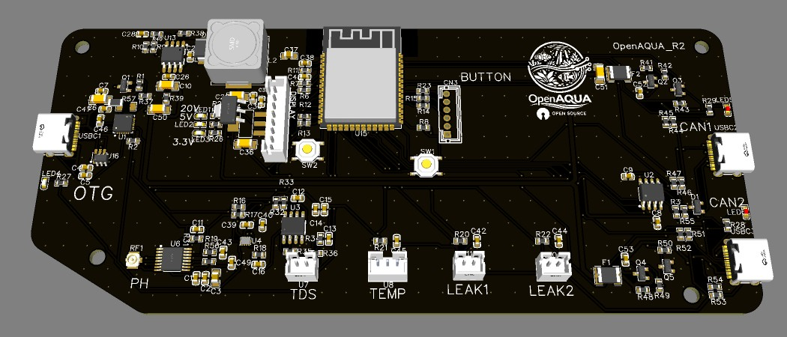
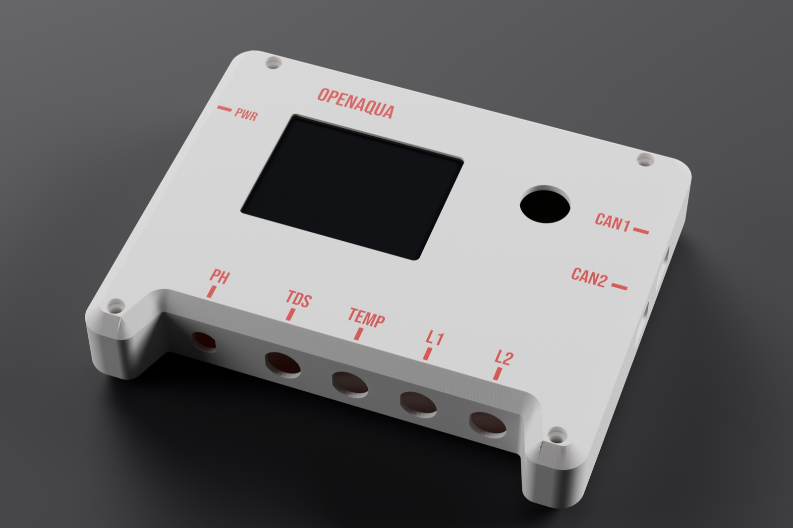
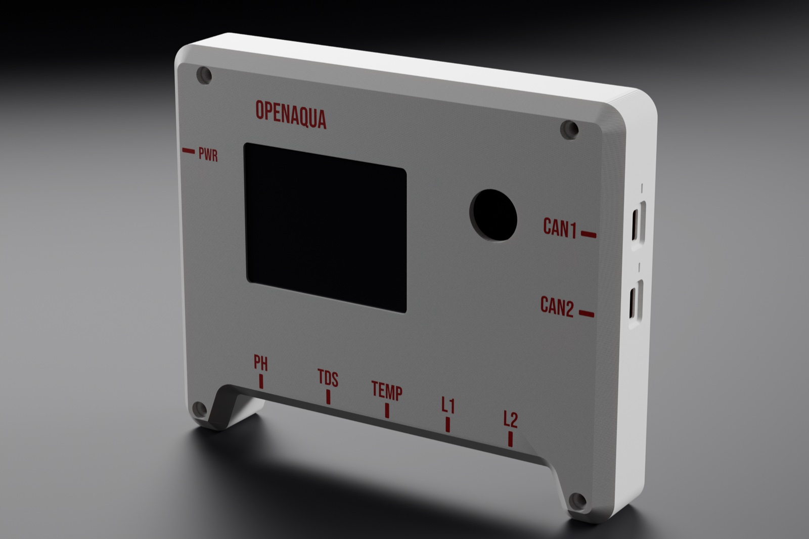
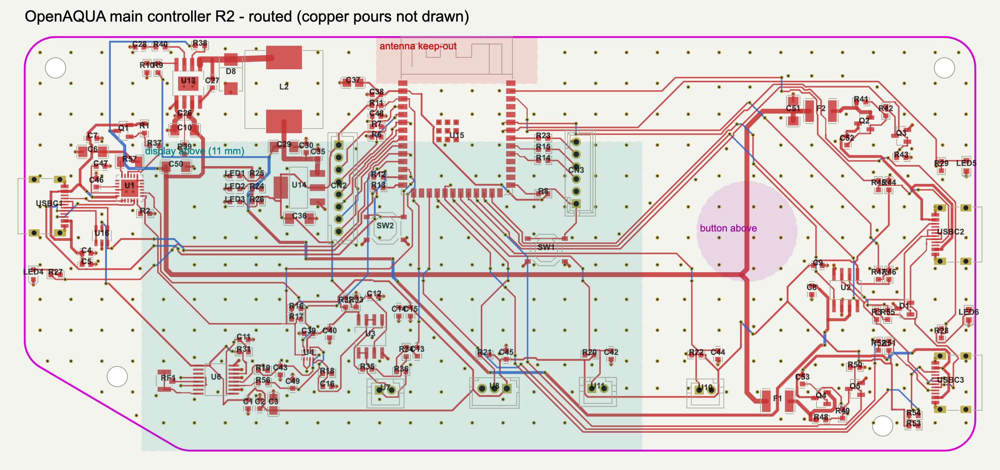
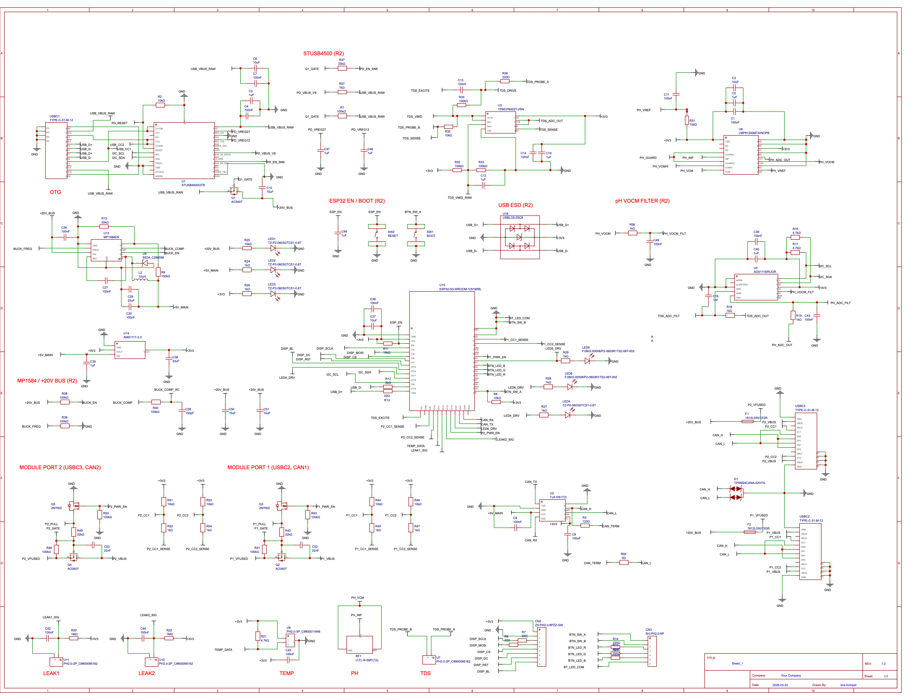
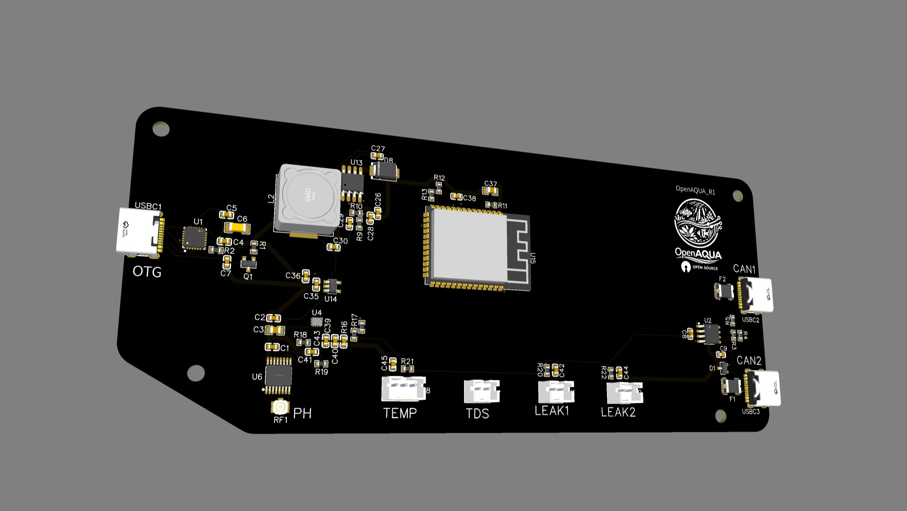
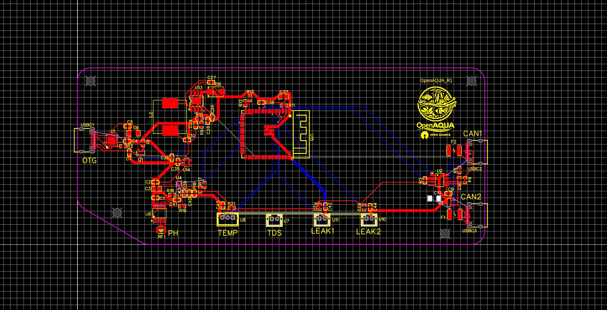

# OpenAQUA

| 3D-printed case (render) | |
|---|---|
|  |  |

🌊 Modular Water System Controller (ESP32 + CAN)

This project is a modular, scalable water system controller built around the ESP32-S3 and a CAN-based expansion architecture. It is designed to monitor and control parameters like pH, TDS, temperature, and leaks, while supporting future expansion modules such as power strips, fleece rollers, and more.

🚀 Why this project exists

Most existing aquarium/reef controllers are:

- expensive
- closed ecosystems
- difficult to expand or customize

I started this project to create a more affordable, open, and expandable system that is not limited to reef tanks, but can also be used for:

- freshwater aquariums
- ponds
- water tanks
- breeding systems
- general water management setups

The goal is a flexible platform where you can build exactly the system you need.

🧠 System Architecture

The system is split into:

🔹 Main Controller (this board)
- ESP32-S3 (WiFi + processing)
Handles:
- sensor processing (pH, TDS, temperature, leak detection)
- system logic & automation
- user interface (display)
- CAN bus coordination
- Button (Estop, Feed, Maintenaince etc)

🔹 Expansion Modules (over CAN bus)

Each module has its own microcontroller and handles:

- local processing
- real-time control
- safety handling

Examples:

- power strip (relay control)
- fleece roller controller
- dosing system
- future sensor modules

🔌 Features (current hardware)

⚡ Power System
- USB-C 
Power Delivery input (PD)
- Up to ~20V negotiated input
Onboard conversion:
- 20V → 5V (buck)
- 5V → 3.3V (LDO, AMS1117-3.3 1 A — R2)

🌐 Communication
- CAN bus (via TJA1051T/3, ±58 V bus-fault protected — R2)
- 2x USB-C module ports (custom CAN + power)
- Designed for daisy-chaining modules

🧪 Sensors
- pH interface using LMP91200 (high impedance front-end)
 TDS input (ADC via ADS1115)
- Temperature sensor input
- 2x leak detection inputs

📊 ADC
- ADS1115 (I²C, high resolution)
- Used for pH and TDS measurements

🧠 MCU
- ESP32-S3-WROOM
Handles:
- WiFi
- CAN communication
- sensor processing
UI

🖥️ UI (planned)
- Small SPI display 
 Status display:
- probe readings
- module status
- system alerts

🔘 Inputs
- RGB button (status + interaction)

🔧 Design Philosophy
- Modular first → everything expandable via CAN
- Local processing → modules handle their own logic
- Main controller = brain → coordination + UI + automation
- Fail-safe design → modules operate safely even if disconnected
- Low cost → uses widely available components
- Open & customizable

📡 CAN Bus Design
- Single shared CAN bus
- Multiple modules connected in parallel
Each module:
- has unique ID
- sends status + heartbeat
- receives commands
- Main controller:
- coordinates all modules
- logs and displays data

📈 Current Progress

✅ Completed
- Full power architecture (USB-C PD → 5V → 3.3V)
- ESP32 integration
- CAN bus with dual ports
- Sensor interfaces (pH, TDS, temp, leak)
- ADC integration (ADS1115)
- Modular system architecture defined
- R2 schematic + 2-layer PCB layout (routed, EasyEDA DRC 0 errors, JLCPCB parts in stock)
- Bring-up firmware (display, RGB button, sensors, leak alarm, module-port detection), tested in the Wokwi simulator

🔄 In Progress
- Community review of R2 before ordering the first prototype (see below)
- TDS analog front-end refinement

🔜 Planned
- CAN protocol definition
- Expansion modules:
- power strip
- fleece roller
- dosing systemen
- closure + mechanical integration

🤝 Community & Contributions

 This project is still evolving, and feedback is very welcome.

👉 Join the Discord:
 https://discord.gg/xk6UMFfCmj

You can:

- suggest features
- propose new modules
- help improve the design
- follow development progress

👨‍🔧 About the project

 I’m not an engineer by profession, but I do have experience with smaller DIY electronics projects. 
 This project is a learning process as well as a practical build, and the goal is to create something useful, flexible, and accessible.

🎯 End Goal

- A fully modular, affordable, and open water control system that can scale from:

- a single aquarium to complex multi-tank, pond, or water management systems

without being locked into proprietary ecosystems.

## Hardware revision R2 (October 2026)

A design review of the original main controller board turned up a number of issues that would
have stopped the first assembled board from powering up at all — most notably the USB-C PD
chip (STUSB4500) was wired so it could never leave reset, and a buck converter catch diode was
installed backwards. R2 fixes these plus a batch of smaller issues (capacitor voltage ratings,
missing CC-based module identification on the module ports, an ESP32 GPIO remap, and a rework
of the pH analog front end), and adds proper USB-C identification for expansion modules.

| Routing (top red, bottom blue) | Schematic |
|---|---|
|  |  |

Full-size schematic: [PNG](docs/images/r2/schematic_r2.png) · [SVG (zoomable)](docs/images/r2/schematic_r2.svg) · copper layers separately: [top / bottom](hardware/main-controller/r2/pcb_preview/copper_top_bottom.png)

See:
- [`hardware/main-controller/r2/`](hardware/main-controller/r2/) — EasyEDA Standard schematic + PCB (import steps in its README)
- [`docs/r2-design-review.md`](docs/r2-design-review.md) — what changed and why, block by block
- [`docs/module-port-spec.md`](docs/module-port-spec.md) — spec for anyone designing an expansion module
- [`docs/gpio-map.md`](docs/gpio-map.md) — full ESP32-S3 pin map
- [`docs/ordering-steps.md`](docs/ordering-steps.md) — from these files to a JLCPCB order
- [`firmware/openaqua-main-r2/`](firmware/openaqua-main-r2/) — bring-up firmware (Arduino, ESP32-S3)
- [`simulation/wokwi/`](simulation/wokwi/) — the same firmware in the free Wokwi simulator, wired like the board

### 🔍 Looking for feedback before ordering the first prototype

The first assembled R2 prototypes cost about €200, so I'd love a second pair of eyes first.
Especially on:

1. **USB-C PD input (STUSB4500)**: pin strapping, reset, VBUS discharge. Does it look right?
2. **Buck converter (MP1584EN, 20 V → 5 V)**: component values and the layout of the switch node, input caps and feedback.
3. **pH front end (LMP91200 → ADS1115 differential)**: guard ring, VOCM/VREF wiring, and whether it will stay quiet next to the buck.
4. **Module ports**: USB-C connectors carrying CAN + switched 20 V, with CC-based module detection (22k Rd) and AO3407 high-side switches. Any safety problem? (See `docs/module-port-spec.md`.)
5. **2-layer layout**: GND return paths, the 20 V trunk, the antenna keep-out.
6. Anything that would stop the board from powering up or being programmed over USB.

Known open points are listed under "Still open" in [`docs/r2-design-review.md`](docs/r2-design-review.md).
Comments are welcome as a GitHub issue, on Reddit, or on Discord.

### Earlier version (R1)

The first layout, kept for comparison. It would not have powered up; see the design review.

| R1 3D view | R1 layout |
|---|---|
|  |  |
